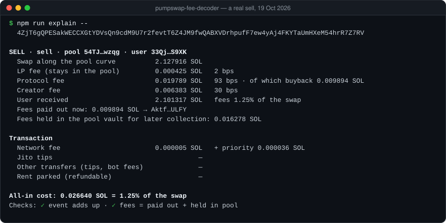

# pumpswap-fee-decoder

[](LICENSE)    

Where the money in a PumpSwap trade actually goes: LP, protocol and creator fees straight from the program's own
events, the buyback share, fees paid out now versus fees left in the pool, network and priority fees, Jito tips,
transfers to other parties (often trading-bot fees) and refundable rent. Read-only.

<p align="center"></p>

## Sample output

A real sell on 19 Oct 2026:

```
$ npm run explain -- 4ZjT6gQPESakWECCXGtYDVsQn9cdM9U7r2fevtT6Z4JM9fwQABXVDrhpufF7ew4yAj4FKYTaUmHXeM54hrR7Z7RV

SELL · sell · pool 54TJ…wzqg · user 33Qj…S9XK
  Swap along the pool curve          2.127916 SOL
  LP fee (stays in the pool)         0.000425 SOL   2 bps
  Protocol fee                       0.019789 SOL   93 bps · of which buyback 0.009894 SOL
  Creator fee                        0.006383 SOL   30 bps
  User received                      2.101317 SOL   fees 1.25% of the swap
  Fees paid out now: 0.009894 SOL → Aktf…ULFY
  Fees held in the pool vault for later collection: 0.016278 SOL

Transaction
  Network fee                        0.000005 SOL   + priority 0.000036 SOL
  Jito tips                                     —
  Other transfers (tips, bot fees)              —
  Rent parked (refundable)                      —

All-in cost: 0.026640 SOL = 1.25% of the swap
Checks: ✓ event adds up · ✓ fees = paid out + held in pool
```

The last 20 transactions of the same pool, after the token had collapsed:

```
$ npm run pool -- DTaPDXwmwL5Pbzrg5PCHCRbp5ujeB7ra265zhNBmpump --last 20

Pool 54TJprXJqaWP8AsMKXAZYMW1zGgmd7UkTdqHasipwzqg · last 20 transactions · 18 swaps (2 buys, 16 sells)
  Volume along the curve             0.121196 SOL
  ...
  All swap fees                      0.001514 SOL   1.25% of volume
  Priority fees: 0.010791 SOL in total, 0.000599 SOL per transaction
  Other transfers (bot / terminal fees): 16 transactions, top recipients: t55h…JFkU 0.010000 SOL, ...
```

On that pool the traders paid seven times more in priority fees than in swap fees, and 16 of 18 transactions also
sent SOL to third parties. The protocol's fee is the visible part of the cost; this tool shows the rest.

The fee schedule itself, read from the fee program's config account:

```
$ npm run tiers

PumpSwap fee tiers by market cap (fee config 5PHirr8joyTMp9JMm6nW7hNDVyEYdkzDqazxPD7RaTjx, read from chain):
  market cap from       LP  protocol  creator    total
  0 SOL                  2        93       30  125 bps
  420 SOL               20         5       95  120 bps
  1,470 SOL             20         5       90  115 bps
  ...                                         (25 tiers)
  98,240 SOL            20         5        5   30 bps
```

## How it works

- **The program's own events.** PumpSwap emits `BuyEvent` / `SellEvent` through a self-CPI (`emit_cpi!`). The decoder
  finds those inner instructions, matches the event discriminator and decodes the Borsh payload with the program's
  IDL — downloaded from chain by `npm run idl`, no generated client. A program upgrade means re-running that command.
- **One invariant for every swap variant.** `buy` and `buy_exact_quote_in` use the same field names with different
  meanings. The decoder relies on what stays in the pool instead: on a buy the vault receives
  `quote_amount_in_with_lp_fee` and the user pays that plus protocol and creator fees; on a sell the vault releases
  `quote_amount_out_without_lp_fee` and the user receives that minus those fees.
- **Two independent checks.** The event's totals must add up, and the pool vault's real balance change must explain
  every fee: fees paid out in this transaction plus fees left in the vault equal protocol plus creator fees, to the
  lamport.
- **What the second check found.** Since late September 2026 a sell does not pay all its fees at once: half of the
  protocol fee goes to buybacks immediately, while the creator fee and the other half stay in the pool vault for later
  collection. A decoder that trusted the event alone would report money that never moved.
- **Everything around the swap.** Base and priority fees from the transaction fee; Jito tips by Jito's published tip
  accounts; any other SOL the trader sent away (other tip services, trading-bot and terminal fees); rent parked in new
  token accounts, counted separately because it comes back when the accounts close; wrapping SOL into the trader's
  own account is not a cost.

## Quick start

Requires Node.js 22.9 or newer.

```bash
npm install
```

```bash
npm run explain -- <transaction signature>
```

```bash
npm run pool -- <pool address or pump.fun mint> --last 30
```

```bash
npm run tiers
```

```bash
npm test
```

`RPC_URL` and `RPC_MAX_RPS` can be set in `.env`; the public endpoint works. `npm run idl` refreshes the bundled IDLs
from chain, `npm run fixture -- <signature>` saves a transaction as a test fixture. The 9 tests cover base58 and Borsh
decoding, real buy and sell transactions down to the lamport, tips and rent, and formatting.

## Limitations

- PumpSwap only; other DEXes emit different events.
- "Other transfers" are SOL the trader sent to anyone besides the pool, the fee recipients and their own accounts — usually
  trading-bot fees or tips to non-Jito services, but the tool does not name the recipient.
- `pool` reads transactions one by one; on the public RPC that is about one per second.

## По-русски

Разбор сделки на PumpSwap до лампорта: сколько ушло поставщикам ликвидности, протоколу и создателю монеты (из событий
самой программы), какая часть идёт на выкуп, что выплачено сразу, а что осталось в пуле, сколько стоили сеть,
приоритет, чаевые Jito и переводы ботам. Сводка по пулу показывает скрытые расходы трейдеров, `tiers` печатает таблицу
комиссий по капитализации прямо с блокчейна.

## Author

Artem Vartanov · [t.me/artemvartanov](https://t.me/artemvartanov). Built with AI assistance (Claude Code). MIT licence.
